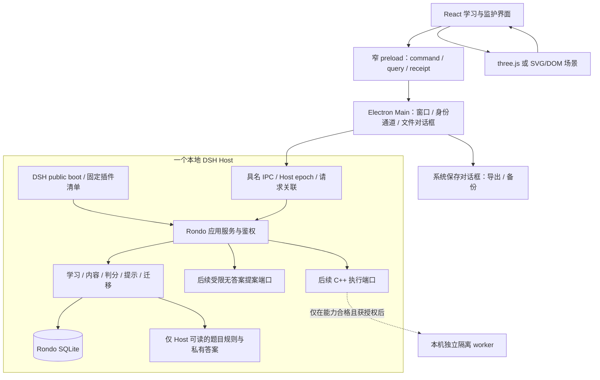

# Rondo：macOS 桌面优先架构 v0.1

日期：2026-10-26。**Owner 在本聊天明确选择“桌面客户端优先、本地保存数据”，首个实际验证平台为当前 Mac。** 这覆盖历史交接和规划原件的浏览器首发约束；Web 界面与领域服务仍保持分离。当前交付是架构与兼容证据，不是已安装的 Rondo App。

## 1. 采用的方案

首版采用一个 Electron 桌面壳、一个使用 DSH 公开启动/插件接口的本地 Host、一套 React Web UI、一份 SQLite 学习数据库和 three.js/SVG 共用的场景协议。当前机器为 macOS arm64，先形成该目标的开发 App；Windows、Intel Mac 和独立浏览器发行不进入首批验收。

Metis 提供公共合同、主进程/Host 分离、命令/查询/回执及退出恢复的参考。Rondo 自建教育领域，不导入 `metis/core`，不复制其 PG、研究调度、模型路由或菜单栏常驻。DSH 承担真实宿主启动与静态插件生命周期；首批没有生成式模型需求，不为证明“用了 DSH”而启动 Agent loop。



首版桌面不启动供学生访问的 HTTP 服务。未来浏览器适配可以通过 DSH `WebServer.register` 承载同一端口，但家庭远程认证、HTTPS、部署和多机写入须另验。当前的 HTTP 兼容探针不把这一未来通路变成产品范围。

## 2. 已核事实与当前差异

输入身份与局部源码核对保存在 [source-readback.json](evidence/source-readback.json)。这里引用证据的实际范围：

| 读取或验证 | 已证内容 | 不能推出 |
|---|---|---|
| Metis `core-api/index.ts`、`client.ts` | 公共接口不导出持久化/凭据/Host 构造；原键查回执模式存在 | 该 SDK 可直接用于教育领域 |
| Metis Desktop main/Host main | Electron 窄 preload、本机 Host 子进程、独立数据根与启动/退出协议有实现参考 | Rondo 桌面已经启动；完整实现可以照搬 |
| OwlCodaE UI 接合说明与 profile/bundle | 公共组合和 UI slot 接合路径存在 | 现成企业/聊天界面适合孩子 |
| DSH 包族身份 | `0.2.1-rc.2.owlcoda.1` 的本地未公开发布候选存在 | 它与 Metis 使用的 `0.2.1-rc.1` 可以混装或已获 Rondo 接受 |
| `dsh-host-webserver`、Cordis 包内元数据与入口 | 选定 tarball 校验和相符；已安装 package.json/lib 入口与包内字节相同 | 全依赖闭包和产品 profile 已验 |
| Node 公共 consumer 探针 | Node 24.18.0、SQLite 3.53.1；受限 HTTP、合成记录、重复命令一次写入、DB 重开读回、监听关闭通过 | 全产品幂等/鉴权/崩溃恢复通过 |
| Electron 可执行文件的 Node 模式探针 | 供体 Electron 44.7.0 对应嵌入 Node 24.21.0、SQLite 3.53.4；同一局部 consumer 通过 | BrowserWindow、utilityProcess、IPC、签名和安装通过 |
| 圆柱试点当前文件与报告 | 六课 PoC 和 17 步报告现已存在；前端判分/localStorage、部分降级提示仍存在 | 在 Rondo 的服务端判分/完整降级或真实学习已接受 |

两次探针没有运行供体 App、修改供体数据或调用模型，临时合成数据库已删除。结果分别见 [Node 结果](evidence/dsh-public-consumer-result.json)和 [Electron Node 模式结果](evidence/electron-public-consumer-result.json)。它们只读借用现有依赖，Rondo 尚无安装目录或锁文件。

## 3. 能力归属与依赖方向

| 能力 | 唯一 owner | 其他层能做什么 |
|---|---|---|
| 窗口、单实例、系统文件对话框、App 退出 | Desktop Main | UI 请求固定动作；Host 提供可导出内容与状态 |
| 固定插件装配、启动审计、技术资源释放 | DSH public boot + Rondo composition | 不拥有学习事实与判分 |
| 身份/家庭范围、课程版本、题目、判分、提示、迁移 | Rondo 应用/领域服务 | UI 和场景提交意图、读取公开投影 |
| 业务事务、幂等记录、学习证据 | Rondo SQLite adapter | DSH Session、日志和 DOM 均非替代事实源 |
| three.js 几何、相机、动画、SVG/DOM 表达 | 场景模块 | 消费公开状态；不决定正确答案或能力状态 |
| 人工解释观察与介入 | 监护领域服务 | 不改写原始孩子表达和确定性判分 |
| 真实编译运行 | 独立隔离 worker，Rondo 掌握准入/回执 | 不获得答案库、家庭库或通用 DSH 工具 |
| 无答案模板提案 | 后续 Rondo 提案 adapter 调用 DSH 公共模型能力 | 提案须校验；无权写题目答案或成绩 |
| 开发任务与验收 | 当前 Rondo 主控 | 产品不读 RunKit 来驱动学习 |

本阶段为单 writer 文档设计，RunKit 采用 `off`；没有初始化或复制 `.owlcoda/runkit/`。若下一阶段确需发包，才按有效技能建立本项目独立控制记录，不继承供体 accepted 状态。

## 4. 新工程布局

一个 private npm 项目、一个根锁文件；目录是代码责任边界，不预先拆成十几个可发布包。下面是下一阶段创建的目标布局，**这些产品目录尚未实现**。

```text
apps/
  desktop/                 # main.ts、preload.cts、Host 监督、数据根与导出对话框
  host/                    # main.ts、composition.ts、静态 profile、IPC router
  web/                     # app.tsx、player/、guardian/、共享可访问控件
modules/
  contracts/public/        # QuestionSpec、命令/查询/回执、场景公开协议
  contracts/server/        # 私有题目/规则与仓储端口；不可进 renderer bundle
  content/                 # 内容发布、构题、先修/映射、模板与提示策略
  learning/                # attempt/cycle、判分、证据、迁移与监护观察
  scenes/                  # 公开状态 reducer/预览、three.js、SVG/DOM 两种表达
adapters/
  dsh/                     # 仅公开 boot/插件/后续提案接缝
  sqlite/                  # typed repositories、migrations、事务/备份屏障
  desktop-client/          # IPC 到 RondoClient 的映射，不带领域规则
content/cylinder/
  public/                  # 题干、许可资源、scene descriptor 与可公开材料
  private/                 # 判分/构题参数、答案、提示放行、迁移模板
workers/cpp/               # 仅选中真实 C++ 阶段才创建
tooling/                   # build、边界检查、版本/打包与定向验收入口
tests/                     # domain、desktop、integration、learning-flow
vendor/dsh/<exact-family>/ # 仅所需闭包、来源、许可证、校验和
docs/                      # 原件与本阶段设计
```

`apps/web`、`modules/scenes` 只能 import public contracts 和显示所需纯函数；不得 import server、sqlite、private content、Node 内建 API。`modules/learning` 依赖注入的 typed repositories，不 import Electron 或 DSH 实现。`apps/host` 是唯一装配根，连接领域与适配器；Desktop Main 不判题。

根 `package.json/package-lock.json`、tsconfig、contracts、schema/migrations 和 composition 保持一个整合 writer。未来可委派内容/场景完整块，但不让多个 writer 同改这些公共边界。先覆盖首两课需要的具体接口，不建立通用工作流引擎、任意插件市场或跨课程微服务。

## 5. DSH 的具体接合

采用 `@deepseek-ai/dsh-app-boot` 公开 `boot(binName, absoluteConfigPath, patches, prepare, bareModuleBaseUrl)`，必要时使用同一公开包的 `createRuntimeResolution` / `PluginPackages` 绑定 Rondo 私有安装锚点。包内声明支持必需插件启动审计；R0 仍须在 Rondo 独立安装中验证其真实拒绝和释放行为。

Rondo profile 只登记自己的内容、业务服务、SQLite adapter 和受限 IPC handler。默认不加载 `dsh-base` 或 `dsh-web-app` 的整个 stock bundle；读取到的包定义包含 shell、文件、终端、设置、动态插件及遥测相关能力。它们即使因依赖解析出现在安装目录，也不能因此成为活动插件。

学生 profile 明确没有：通用 shell/terminal、任意 fs、浏览器/网络抓取、MCP、动态代码/插件 runner、模型账户管理、通用聊天、Agent 自动调度、会话标题模型、自动反馈上传或产品遥测。默认不安装/装配模型 provider。关闭 UI 按钮不算隔离：IPC router、插件清单和调用权限都须拒绝这些能力。

启动仅读 Rondo 的打包配置、数据根与显式允许的环境项；不自动读取工作目录、OwlCodaE 或用户默认 DSH profile/.env/凭据。缺少必需插件、版本不符、重复 handler 或额外未批准插件均拒绝 READY。首版不做 HMR 或运行中插件增删。

three.js 不是 DSH 通用工具。场景代码是 Rondo 签定内容发布的一部分，由 React 组件加载明确 renderer；它不能通过 DSH 调脚本或把 Mesh 状态写成学习事实。DSH 未来的技术 Session 也只存最小技术事件，不存孩子原话、答案或学习档案。

## 6. 桌面进程与运行边界

Desktop Main 注册 `rondo://app` 自定义安全协议，仅映射打包的公开资源目录；路径规范化后仍必须验证属于该目录，禁止导航到远程内容和创建任意窗口。Renderer 设 `nodeIntegration=false`、`contextIsolation=true`、`sandbox=true`；IPC 每次校验 sender/frame/协议及消息 schema，preload 只暴露固定函数。系统权限请求默认拒绝，首批无需摄像头/麦克风。这些措施与 Electron 官方的[安全建议](https://www.electronjs.org/docs/latest/tutorial/security)一致；实际配置仍由 R0/R2 验证。

Host 使用 `utilityProcess.fork` 启动打包内的固定入口，入口路径、dataRoot 和允许环境由 Main 给定；不使用用户 PATH 搜索 Node，不执行 renderer 给出的文件。Host 是正常本机进程，不宣称它能安全运行学生代码。当前探针运行的是 Electron 的 Node 模式，**utilityProcess 生命周期和消息通路尚未验证**。

消息包含 requestId、protocolVersion、hostEpoch、sender binding；Main 丢弃来自非当前 Host 的迟到响应。权限会话由 Host 验证，Main 的窗口来源检查不能代替家庭授权。与 Host 断开时，所有待回执写命令转为送达未知；查询可以重发，写命令按原键查回。

首版一个主窗口，默认关闭窗口就是退出流程，不隐藏常驻。真实 Host 退出前不宣称保存结束；未保存草稿可取消退出或明确放弃，确认记录不丢失。睡眠/恢复与更新重新进入 RECOVERING，读取未决回执与内容绑定后才允许继续学习。详见[生命周期合同](LIFECYCLE-DATA-API.md)。

## 7. 工具链与锁定策略

以下是**精确的输入候选**，不是 Rondo 独立安装接受清单。选这些版本的依据是当前供体实物、已有本地运行时和本次有限 consumer 证据，不是复制任一旧锁文件。

| 项目 | 输入候选 | 本次证据与 R0 需要补的边界 |
|---|---|---|
| 构建 Node / npm | `24.18.0` / `12.0.1` | 当前命令读回；Node consumer 已跑；仅项目内选用，不改全局 |
| Electron | `44.7.0`，当前 macOS arm64 | 供体安装包与 Node 模式运行；嵌入 Node 实际 `24.21.0`，不能写成构建 Node |
| DSH 包族 | `0.2.1-rc.2.owlcoda.1` | 公共包实物与局部消费；须锁定实际最小闭包，不能夹入 Metis `.rc.1` |
| Cordis | `4.0.5` | 选定 tarball/安装入口相同；依赖需随闭包固定 |
| React / React DOM | `18.3.1` / `18.3.1` | OwlCodaE 安装元数据；Rondo renderer 构建/运行待验 |
| TypeScript / esbuild | `5.8.3` / `0.28.2` | 供体安装元数据；renderer/host 双构建待验 |
| three.js | 候选 `0.186.1`；供体文件报告 revision `186` | 试点 README 与两份 JS hash 已保存；R0 核正式包版本/许可证/字节来源后才锁安装 |
| SQLite | `node:sqlite`，随嵌入 Node 固定 | Electron 探针为 `3.53.4`；开发 Node 为 `3.53.1`；业务/迁移以打包运行时验收 |
| 类型声明、打包/验收辅助依赖 | R0 从实际 API 与工具链解析后精确记录 | 不把供体 `@types/node 22.15.3` 直接冒充 Node 24 接口；不预填未核版本 |

R0 创建唯一根 manifest、`package-lock.json`、项目版本入口和 `toolchain.json`。所有直接依赖写精确值；vendor 引用必须使用项目内相对路径，保留 tarball SHA-256/许可证。传递依赖在锁文件中绑定版本/integrity；根 overrides 仅用于保持已选择的 DSH/Cordis 族，不强压不兼容依赖。

R0 在新项目用 `npm ci` 重建并核 engine/peer/公开导出、实际闭包及零额外活动插件。构建和运行身份分别写入 `toolchain.json`；Electron 的 ABI/内建 SQLite 不能由 shell Node 版本代替。不得软链供体 node_modules、直接引用供体绝对路径作为产品依赖，或以 `--force` 忽略冲突。本阶段不制造尚未解析安装的锁文件。

目标开发入口由 R0 实现后才可用：`npm ci` → `npm run typecheck` → `npm run build` → `npm run dev:desktop`。构建采用 esbuild 分别生成 Main、preload、Host 和 Web 资源；CommonJS preload 与 ESM Host 明确分开。`npm run check:boundaries` 检查 renderer 无 server/private/Node import，`npm run check:desktop` 用合成数据验证实际窗口与 Host，`npm run package:mac` 仅产本地候选。当前没有这些脚本，不能在文档完成时声称已可启动。

## 8. 存储、打包与恢复

建议 App ID `local.rondo.desktop`、显示名 `Rondo · 回旋曲`；数据根固定为当前 macOS 用户 Application Support 下独立 `Rondo/`，不复用任何供体根。真实路径由平台 API 给出，运行时读回到本机诊断页。

```text
Rondo/
  learning/learning.sqlite   # 唯一业务事实库及其 WAL
  content/                  # 安装/导入的完整内容版本，私有内容不由 renderer 协议提供
  desktop/                  # 独立 Electron session 与每学习者草稿
  technical/dsh/            # 必要的技术状态；无儿童原文/外部遥测
  technical/logs/           # 脱敏错误、版本、耗时；不记录请求 payload
  temporary/                # 当前导出或将来执行的具名临时目录
```

SQLite 的选择服务于当前单机/单 writer；不新增 PG 或容器作为两课前置。备份在写入屏障下使用一致快照，不能直接复制正在写的一个 `.sqlite` 文件而漏掉 WAL。备份/恢复的最低产品保证和删除后的恢复顺序见生命周期合同；真实家庭开始前必须用该候选验证一次新目录恢复。

安装升级先核 App/内容/schema 身份，关闭当前 Host，保存可恢复快照，再应用具名 schema 迁移。回退需要旧 App 与对应数据快照成对使用；新 schema 不兼容时禁止旧版本直接打开。首批不做自动更新服务；签名、公证、安装到 Applications、公开下载和正式发行都不是本阶段授权。

## 9. C++：真实执行与教学步进两条明确边界

真实代码使用成熟 C++ 编译器；语言标准以规划中的 C++11 为首个教学合同，未来考级须核当期规则，不在此文承诺报名兼容。Clang 官方支持用 `-std` 明确语言模式，编译选项由 worker 固定，不能从学生输入拼接任意命令。[Clang 使用手册](https://clang.llvm.org/docs/UsersManual.html)

路线选择：若 Owner 将真实 C++ 纳入实施，首个执行后端采用**本机独立隔离的 Linux worker，位于受控轻量虚拟机中**。只在同一 Mac 内传递代码与题目输入，不上传云端；没有合格隔离环境时返回 `CAPABILITY_UNAVAILABLE`，数学/步骤卡仍可使用。虚拟机创建、运行资源和编译器工件的引入是 R4 的具名授权边界，本阶段不启动容器或 VM，不把 macOS 普通子进程当安全执行环境，也不并建 WASM 第二执行器。

固定 `ExecutionRequest`：jobId、attempt/submission、source bytes/hash、compilerContractId、languageStandard、公开输入、limits、fence。worker 只接源代码/有限输入/执行合同，不接私有答案、家庭库、DSH token 或用户目录；Rondo 用私有规则核对输出。隐藏测试的期望输出留在 Host，不把整个答案库挂进 worker。

初始资源合同候选：源代码 32 KiB、输入 16 KiB；编译墙钟 30 秒/内存 512 MiB；运行 CPU 2 秒/墙钟 3 秒/内存 128 MiB；输出 64 KiB；临时可写目录限 8 MiB；运行时不允许创建子进程、联网或访问共享宿主目录。编译阶段自身也必须隔离，限制进程树与文件；这些是待验证限制，不能凭配置文本声明已强制执行。compiler version、目标架构、sysroot、镜像 digest 与实测限额在 R4 开工时冻结。

运行生命周期为 `ADMITTED → QUEUED → COMPILING → RUNNING → FINISHED`，结果细分 `COMPILE_ERROR/RUNTIME_ERROR/TIME_LIMIT/MEMORY_LIMIT/OUTPUT_LIMIT/OK`。取消先为 `CANCEL_REQUESTED`，实际进程树停止后才 `CANCELLED`；无法确定为 `UNKNOWN`，重启核对原 job/fence，不再开一次运行。

教学步进首版是登记过的 `rondo-step.v1` 程序模板与槽位：变量赋值、顺序算术、结构化 if 和有界 for（后两者到相关课再启用），最多 200 步；可视化变量表、当前步骤与输入输出。它不是任意 C++ 解释器。与模板不匹配的学生代码显示“此代码暂不提供步骤演示”，真实编译结果独立返回。步骤模板中 `int` 宽度、整数除法、作用域、溢出禁区与 double 近似须用选定编译器例子校准，不能把有未定义行为的程序演示成确定答案。

## 10. 离线 AI 与未来提案

首期使用三类标明来源的材料：人工编写的错误建议、合成样本、固定版本的确定性分类实验。分类器预测是被孩子检验的对象，不能评价孩子，也不进入标准答案。无需模型账户、联网和计费。

未来生成式提案接口只接收预审通用主题/模板目录与允许的枚举槽位，不传孩子的表达、代码、身份或学习日志。输出形如 `{templateId, templateVersion, slotSelections}`；拒绝多余字段、任意文本/URL/脚本、未登记模板或越界槽位。Host 根据自己的内容策略构题、选提示和计算答案，模型原文不直接显示给孩子。

开通真实 provider 前必须绑定实际 provider/model/账户、数据白名单、发送边界、计量与预算、关闭背景调用并证明 UNKNOWN 不重复发送。当前架构没有账户凭据，也没有付费调用权限。DSH 技术会话结束或模型返回 JSON，都不能使一个学习任务变为完成。

## 11. 架构接受边界与当前唯一实施缺口

本设计已经选择模块、事实 owner、平台、数据路线和公开端口。尚缺的第一个实施证明是：**Rondo 独立锁定安装 → 最小 DSH public boot → 实际 macOS 窗口/preload/Host IPC → 本地事务与关闭重开**。这由 R0/R1 顺序完成，不要求先迁入旧题库、先做真实 Tutor、先解决六课全部旧问题或先启动 C++ 环境。

架构文档完成不等于 R0 完成；局部 consumer 绿灯不等于桌面运行通过。后续每层只补自己的实际证据，完整任务依赖与停止条件见 [DELIVERY-PLAN.md](DELIVERY-PLAN.md)。
