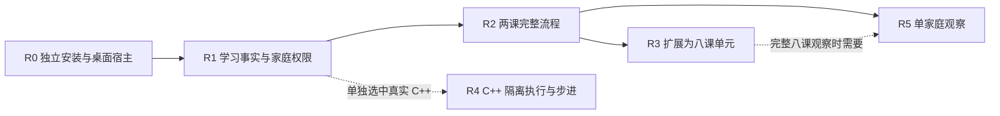

# Rondo：复用处置与去重实施表 v0.1

本表属于本阶段设计交付，**没有派发实施、没有创建新代理或 RunKit execution**。当前唯一 writer 是本 Rondo 聊天；下一阶段实施须绑定明确范围。最新平台是 macOS 桌面优先、本地存储。

## 1. 首批范围与唯一下一动作

建议首批只启动 **R0 → R1 → R2：macOS 上的两课完整学习流程**。孩子从进入、预测、操作、提交、解释到再次打开继续，监护人能查看帮助和学习证据；使用步骤卡和离线 AI 材料，不启用真实 C++、生成式模型或真人数据。

唯一下一动作：由 Owner 确认该范围及投入上限后，当前主控启动 R0 的独立工程安装与桌面闭环。当前授权足够完成的立项/架构准备已完成；本表不是产品实现开工回执。确认平台为 macOS 不自动等于批准全八课、付费调用、Git 发布或正式安装。

本批采用一个实际实施 writer 串行推进公共接口、存储与装配；不额外开配对主控。若后续存在可隔离完整块才委派，默认 Sol-high；没有具名难题不例行升档或加独立审查。

## 2. 资产复用处置

“直接复用”仍需本项目消费证据；“适配”保留原语义但重新绑定接口/权限；“重做”只覆盖当前目标，不回修供体；“延期”不成为首批依赖。

| 资产与准确来源 | 处置 | 采用什么 / 必须改变什么 | 证据与责任落点 |
|---|---|---|---|
| Rondo 两份规划原件 | 直接复用，原字节保留 | 愿景、能力先修建议、八课教育意图；最新平台决定单独覆盖 | 两个 SHA-256 与交接相符；本阶段文档 |
| [Metis 架构](../../../../Metis/docs/architecture/core-first-20261013/ASTRA-ARCHITECTURE.md)及接收记录 | 适配设计模式 | 公共接口、单事实 owner、回执/未知、Host 生命周期；不照搬研究业务/PG/全量内核 | 本轮定向阅读；R0/R1 |
| [Metis 公共 client](/Users/yeemio/AI/gitrep/Metis/packages/core-api/src/client.ts) | 适配接口模式 | 原幂等键查回执；Rondo 自己定义教育命令和家庭 scope | 原码存在；R1 重写业务接口，不 import Metis SDK |
| [Metis Desktop main](/Users/yeemio/AI/gitrep/Metis/apps/desktop/src/main.ts) | 适配机制 | 窄 preload、窗口/Host/数据根分开；不带入 Docker DB、菜单栏、旧环境/凭据 | 当前局部源码读回；R0 |
| [DSH 固定包族](/Users/yeemio/AI/gitrep/OwlcodaE/vendor/dsh/0.2.1-rc.2.owlcoda.1/ARTIFACT_IDENTITY.json) | 直接复用所需公共包，适配 profile | `app-boot`/Cordis/必需基础闭包；Rondo 独立版本/路径/许可清单；不加载 stock 通用工具组合 | 两个包局部 hash/consumer 证据；R0 全闭包与实际启动另验 |
| [OwlCodaE Web 接合](/Users/yeemio/AI/gitrep/OwlcodaE/docs/ui-dsh-integration/README.md) | 适配思想，UI 不照搬 | 公共扩展、请求/回执绑定；企业侧栏、聊天面、通用设置不进入学生产品 | 本轮只读；R0/R2 采用自己的产品界面 |
| [圆柱试点几何与场景](/Users/yeemio/AI/gitrep/OwlChen-3d-pilot-cylinder-20261026/lab/index.html) | 适配 | 圆柱/展开视觉思路与部分二维表达；拆成无答案 renderer，与服务端确认状态连接 | 快照 hash `8ad71068…`，17 步为供体历史报告；R2 |
| 试点 `deterministicJudge`、页面答案、localStorage 完成态 | 重做 | 服务端规则、私有题目、事务记录、恢复；不能把前端判分搬进 Rondo | 已读到具体函数与存储路径；R1/R2 |
| 试点六课和降级 | 逐课适配，未选课延期 | 新事实是六课 PoC 已有报告；L1/L4 部分降级仅提示不满足本合同，所选操作须补可操作二维 | R2 只消费前两课必要资产；R3 按课处理后续差集 |
| OwlChen 教材注册、461 任务/25 实验室 | 延期至具名消费 | 当前只用原需求说明其候选价值；不扫描/复制整库，不把失败行当独立缺陷 | 未重跑；旧产品目录只核存在；以后按确切源文件/hash 接收 |
| 旧 Tutor 离线权限/预算设计 | 延期实现、保留边界 | 参考原规划中的授权与 UNKNOWN 原则；不认为真实网关已经可用 | 未新核其源码/运行时；首批零 provider |
| 原创八课说明、提示、迁移与监护读面 | Rondo 新设计/实现 | 同一内容块同时交付问题、场景、服务端 rubric、证据和降级 | R2/R3，不能分别另造数学/编程/AI 播放器 |
| C++ 执行与教学步进 | 新建受限后端/模板，首批步骤卡 | 不复用 DSH shell；真实执行待 R4 独立隔离与成熟编译器证明 | R4 条件任务，不阻塞 R0–R2 |

供体任何源码、数据库、控制记录、进程、在途 writer 都保持原状。本阶段只读到六课报告的变化，不向原聊天发消息，也不替原项目宣布接受或结束任务。所有输入快照见 [source-readback.json](evidence/source-readback.json)。

## 3. 去重后的任务图

任务状态均为 `DESIGNED_NOT_STARTED`。R0 已有局部兼容准备，但不是 R0 接受。不存在“必须等旧六课 writer ACK 才能开始”的隐藏依赖，也不存在“先修完旧 159 个缺陷”的前置。

### R0 — 独立工程与真实 macOS 宿主

目标：从 Rondo 自己的锁定安装启动实际窗口和 DSH Host，能看到正确应用身份、当前数据根、READY/失败状态，并干净关闭。使用合成数据，不读取任何供体运行数据。

依赖：Owner 批准 R0–R2 范围；本目录设计基线。允许路径：根 `package.json/package-lock.json/toolchain.json/.gitignore/tsconfig*.json`，`apps/desktop/**`、`apps/host/**`、`apps/web` 的壳入口、`adapters/dsh/**`、`adapters/desktop-client/**`、`modules/contracts/public` 的运输协议、`vendor/dsh/**`、`tooling/**`、`tests/desktop/**`、具名 evidence 目录。公共文件仅该 writer 修改。

交付：精确依赖闭包与来源/许可证；本项目启动配置；打包身份和独立数据根；`utilityProcess` Host 与窄 preload；必需插件审计；启动、退出和恢复入口；`npm ci/typecheck/build/dev:desktop/check:boundaries/check:desktop` 真实脚本。只能借用供体读取来源，不能让运行依赖指向供体路径。

接受：实际 Mac 窗口发具名只读请求到真实 Host；依赖锁可重建；未知 IPC/伪造 sender/未登记插件被拒；通用工具和自动模型调用未装配；Host 停止后窗口如实显示不可用；关闭后确认本次 Host 已退出；再次启动使用同一独立根。Node 模式或空页面截图不足以接受。

停止：稳定候选与此范围证据回当前主控。缺闭包/公开启动能力时只返回具体包、接口、错误与最小改法；不升级全局、不改供体、不先做课程业务。开发候选构建不包含安装到 Applications、签名公证或公开发行。

### R1 — 服务端学习事实、权限与恢复

目标：用两课所需的合成题目贯通领域命令、SQLite 事务、内容私有绑定与家庭权限；获得可靠的恢复点与回执，不依赖前端判分。

依赖：R0 ACCEPT。允许路径：`modules/contracts/**`、`modules/learning/**`、`modules/content/**` 的运行协议与构题骨架、`adapters/sqlite/**`、`apps/host/**` 的服务装配、`tests/domain/**`、`tests/integration/**`、合成私有 fixtures。根依赖/公共 schema 如需变化仍由当前唯一整合 writer 更新。

交付：本合同具体 typed repositories/migrations；attempt/cycle/预测/操作/提交/解释/提示/人工观察；内容版本和撤销；权限会话；原键 receipt；断连未知与恢复；导出/删除/备份服务边界。同步结果、事件和 receipt 同事务，未通过持久化不能显示保存成功。

接受：两个合成家庭互不可读写；伪造 learner/guardian 被拒；并发旧 version 被拒；同键重放仅一次 effect、改 payload 被拒；commit 后断开仍可查回；未知 renderer/私有版本错配不判题；错误答案与技术失败分开；人工注释不改原始判分；私有答案不进入公开投影；受控备份到新目录后能恢复同一证据链。

停止：以稳定源码和实际本地存储证据接受，不宣称课程/真人已接受。未选的代码执行和 provider 端口明确返回 unavailable，不生成虚假结果。

### R2 — 前两课、同一播放器与监护读面

目标：实际 Rondo App 内完成 L1/L2 的完整学习流程和一个陌生情境任务；退出重开可继续，监护人能读懂问题、提示与解释。

依赖：R1 ACCEPT。允许路径：`content/cylinder/**` 的 L1/L2 与共享迁移内容、`modules/scenes/**`、`modules/content/**` 的相应内容注册、`apps/web/**`、`tests/learning-flow/**`、对应内容审阅记录。若需要改 contracts/sqlite/desktop，由当前主控整合具名差集；不得并写公共边界或复制供体完成状态。

交付：L1 参数与视角、L2 展开关系；原创引导/独立/陌生题与 server rubric；three.js 和 SVG/DOM；键盘入口；步骤卡；预测/确认/反馈/解释/恢复的一个播放器；监护证据时间线、介入补录、导出/删除界面；明确保存状态；约 7–14 天后可用的独立迁移安排。首批不做外发提醒或后台模型。

接受：在当前 Mac 实际窗口里以合成学习者完成两个课、陌生任务和回看；所有关键操作纯键盘可达；WebGL 初始失败与运行中失效后仍能完成同目标；高细圆筒不误标周长边为长边；UI/资源无私有答案；断开/退出/重开无重复计分；监护人读回提示与解释，导出/删除范围正确。内容审阅核目标、计算、语言和反例，不能只看测试通过。

停止：工程与内容候选回当前主控 ACCEPT/REWORK；真实学习效果保持未验。两课闭环接受即停止该批，不自动扩展八课、安装产品或招募家庭。

### R3 — 八课连续单元与所选旧资产差集

目标：补 L3–L8，形成能继续、回看与迁移的八课单元。依赖 R2 ACCEPT 和单独范围批准；若两课真实观察已提供修正意见，先纳入影响当前课程的差集。

允许路径：`content/cylinder/**`、`modules/scenes/**`、`modules/content/**`、`apps/web/player/**` 的同播放器扩展、`tests/learning-flow/**`。责任是一位内容/场景实施 writer 对同课的提问、操作、判分、提示与降级共同负责，不按数学/编程/AI 拆三份。公共核心改动由现有主控整合。

接受：八课在同一版本体系连续可用；每课有所需前置、独立任务、解释与迁移；后六课降级也可完成目标；有限层叠/公式动画不冒充证明；单位、圆锥条件、枚举和合成模型错误如实呈现。旧缺陷只处理实际消费路径的共享机制，保留其来源与新边界证明，不为关闭旧行数凑修复。

停止：八课工程/内容接受即停。未消费的旧实验室、全教材和完整考级映射保持延期。

### R4 — 可选真实 C++ 与有限步进

目标：在本机受控隔离环境用成熟编译器真实运行学生程序，输出可核对回执；步骤展示明确支持范围。

依赖：R1 ACCEPT；Owner 选择 C++ 范围并授权本机隔离执行环境与资源；此时才冻结工具链工件和镜像。允许路径：`workers/cpp/**`、`modules/contracts` 的执行合同、Host 执行 adapter、`apps/web/player/code/**`、相应内容和限额/语义验证。禁止在业务 Host、Desktop Main 或 DSH shell 执行学生代码。

接受：真实编译/运行、错误诊断、输出/时间/内存限制、网络/文件/进程边界有实际证明；死循环和输出洪泛不会拖垮 App；取消/重启/迟到结果不重复释放；sourceHash/编译器/标准/输入/限制/worker 身份能读回。有限步进与选定编译器校准，不支持的代码如实关闭步进。真实代码留在本机，worker 无答案库和家庭库。

停止：具体工具链与受限语义接受；不宣称任意 C++ 安全、完整考级覆盖或云执行已获授权。R4 不成为未选择 C++ 孩子的学习前置。

### R5 — 单家庭使用与学习观察

目标：回答当前孩子在哪里获得帮助、在哪里受阻，保留起点、提示负担和延迟迁移证据。

依赖：R2 工程/内容 ACCEPT；真实家庭范围、安装/使用和本地数据政策明确授权；若验证完整八课，另要求 R3 ACCEPT。允许范围是经批准的本机产品安装/配置与家庭数据目录，不写供体。真实数据不得放入 Git、交付包、模型上下文或外部遥测。

先做少量无提示起点任务，记录阅读/输入障碍；使用中记录介入类别和大致耗时；结束后用陌生任务观察；约 7–14 天后再看迁移，实际间隔如实记录。解释看条件、关系和依据；三维与二维可做相近任务对照，但顺序/练习效应保留，不能宣称普遍因果增益。

接受：监护人能读懂具体证据与下一步，问题有可执行改进；源码通过、家庭可用、学习观察分别给结论。单孩子不关闭市场需求、付费意愿或年龄泛化。达到这一轮观察目的即停，不自动招募更多家庭或宣传效果。

## 4. 共用修改与验收责任

本阶段所有任务均未分派。实际启动时在同一 Rondo 控制记录中绑定：任务 ID、当前目标与授权、真实 writer/模型/会话、稳定候选 manifest（未提交时 `commit=null`）、允许/保护路径、依赖接受证据、可运行命令、原生回传路径与停止条件。不伪造 commit、执行身份或 PASS。

根依赖、公共合同、全部 SQLite schema 与 DSH/desktop 装配由一位整合 writer 维护。若委派 R2/R3，实施者只交付完整内容/场景候选；合同变化返回精确差集，由当前主控整合。收到稳定结果后由当前主控 ACCEPT/REWORK/BLOCKED，不因换模型重复有效验收。

严格 TDD 未获授权。实现使用现有失败、针对性行为证明和实际消费读回；只有具体高风险行为确需严格 TDD 才单独说明收益并征得同意。不为文档、拆目录或代理数量写测试。

## 5. 首批必须保留的风险与拒绝条件

| 具名问题 | 现在的决策 | 会改变下一决定的证据 |
|---|---|---|
| DSH 独立闭包与真正桌面消费未验 | 保留选定包族，R0 补齐；不重新海选底座 | public boot/必需插件/实际窗口与 Host 不能完成则返回具体缺口 |
| 构建 Node 与 Electron 内嵌 Node 不同 | 分别记录；数据库以嵌入运行时为接受环境 | ABI、导入或 SQLite 行为冲突才调整具体依赖 |
| 私有答案/儿童数据进入 renderer 或遥测 | 阻断 R1/R2 接受 | 实际 bundle/资源/IPC 投影与活动调用读回 |
| 供体场景只有提示式降级 | 所选课在 Rondo 补可操作路径 | 强制 context loss 后无法完成同目标则返 R2/R3 |
| C++ 隔离尚无产品环境 | 真实执行保持 unavailable；步骤卡可先交 | R4 实际边界证明与运行权限 |
| 真实学习效果未知 | 工程接受后再进入授权的 R5 | 起点、帮助、独立表现、真实间隔后的迁移 |

未列出的非必要发现记录到对应后续任务，不另起研究、制包链或巡检代理。供应包未公开发布、商标待核、真实服务分类/数据要求待专项核对，是相应发行/商业边界的事项，不把它们伪装成当前原型架构已经合规或成熟。

## 6. 范围外操作

未经明确授权仍不执行 add/commit/push、PR、公开发布、正式部署/安装、容器/VM 启动、付费模型或儿童数据传输。所有供体和原规划原件保护。R0–R2 的未来批准只授予其中写明的本地实施范围，不自动批准上述动作。

人员、成本和家庭时间未给出，原规划的周数仍只是条件估计；本表不新增硬排期。第一笔实际投入应记录两课工程/内容制作与返工，再估八课扩展，而不是从旧任务数量推导成本。
