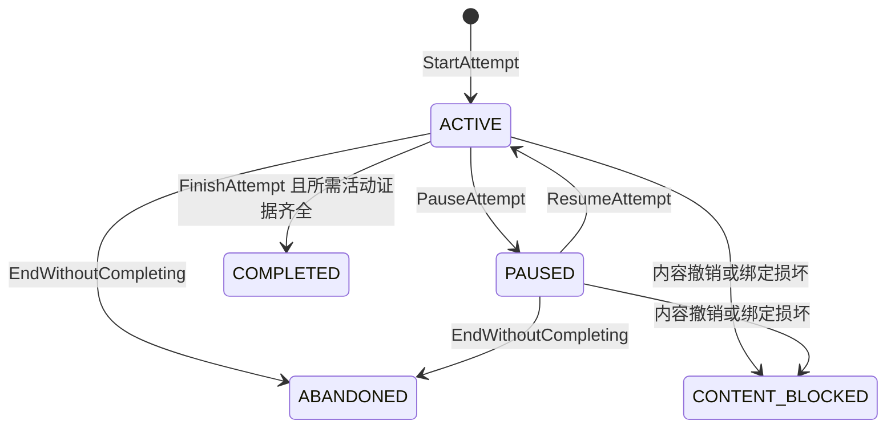

# Rondo：生命周期、数据与公开接口 v0.1

这是供实现使用的领域合同，不是已存在的 SDK 或数据库。最新平台决定为 macOS 桌面优先、本地存储；Web UI 经窄 IPC 消费本合同。未来 HTTP 适配也只能使用同一应用服务，不能另外写一套判分器。产品目标见 [PRODUCT-CONTRACT.md](PRODUCT-CONTRACT.md)。

## 1. 身份与版本

| 对象 | 身份与不可变内容 | 可变内容及 writer |
|---|---|---|
| 内容发布 `ContentRelease` | `releaseId`；课程/任务/生成器/判分/场景协议版本；公开资源 hash；私有绑定仅在 Host | 发布资格 `DRAFT/REVIEWED/AVAILABLE/RETIRED/REVOKED`；本地内容管理流程 |
| 题目实例 `QuestionInstance` | `questionInstanceId`；固定 release/task；题干参数、数值口径、公开初始状态、服务端私有规则引用 | 不原地改题；错误内容撤销后开新实例 |
| 学习尝试 `LearningAttempt` | `attemptId`、家庭/学习者、课次、内容绑定、开始时间 | `version`、当前 cycle、活动状态；学习领域服务 |
| 探究轮次 `LearningCycle` | `cycleId`、题目实例、初始给定条件 | 阶段、确认场景状态、最后 seq；学习领域服务 |
| 提交 `Submission` | `submissionId`、题目/轮次/确认状态版本、响应原文、提交者与帮助快照 | 不覆盖；修正是新 submission，引用前次 |
| 判分 `Evaluation` | `evaluationId`、submission、规则版本、判分结果、受限反馈 | 不静默重判；修正规则产生更正记录 |
| 过程证据 `LearningEvent` | `eventId`、attempt、服务端单调 `seq`、command、事件类型、负载 | 追加；不以客户端时钟排序 |
| 回执 `CommandReceipt` | `commandId`、幂等范围、服务端 payload hash、绑定版本、effect 引用 | 原子落库；外部执行准入与最终结果分开 |
| 人工观察 `GuardianObservation` | reviewer、被观察证据、量规版本、内容与时间 | 修改追加 revision，不覆盖孩子原文或判分 |

题目版本、renderer 版本、数据库 schema 版本和桌面发行版本是不同轴。已有 attempt 继续使用创建时的完整绑定，不因为安装了新课或新 App 自动切题。客户端回传版本只作为一致性检查；真实绑定必须从 Host 中读取。

公开资源 hash 不包含私有答案或私有测试的 hash。小答案域的 hash 也可能泄露答案，不能把它当脱敏字段。`releaseId` 可以公开；它指向哪些私有文件只由服务端解析。

## 2. 内容生命周期

`DRAFT → REVIEWED → AVAILABLE → RETIRED`。答案错误、越权或泄露等实质问题从任何已发布状态进入 `REVOKED`。

- `REVIEWED`：原创来源/许可、题干、参数域、判分和提示由内容审阅者核对；还不能出现在推荐入口。
- `AVAILABLE`：当前安装中所需 renderer、schema、服务端规则和资源完整且已接受，才能创建新 attempt。
- `RETIRED`：不建新尝试；完整旧绑定仍可恢复与查回历史。
- `REVOKED`：停止相关新准入和继续判分，已有 attempt 标记 `CONTENT_BLOCKED`；保留解释、旧判分及撤销原因。提供经确认的新尝试，不把旧记录迁成新课的完成态。

一个内容发布必须声明它支持 `WEBGL2` 与 `SVG_DOM` 两种表达的哪些操作；缺少关键降级操作时不能把该课标为 AVAILABLE。未知 task、schema、renderer 或版本一律拒绝，不落到“通用渲染器”猜着运行。

## 3. 学习生命周期

尝试的活动状态与学习质量分开：



`COMPLETED` 表示这次学习流程已结束；数值正确、解释充分、独立完成和迁移观察分别是结果字段。一次流程结束可以带着“还需要练习”的结果，不能自动解锁整组能力。完成后再练习创建新 attempt，带 `previousAttemptId`，不复活旧终态。

每个 cycle 使用 `PREDICT → OPERATE → VERIFY → EXPLAIN → REVIEW`：

| 阶段 | 进入/离开要求 | 保留什么 | 失败或重试 |
|---|---|---|---|
| PREDICT | 题目已创建；首次预测成功落库才进入操作 | 首次预测、当时已知条件、帮助状态 | 空值/格式错不推进；可以明确填“不确定” |
| OPERATE | 只允许题目白名单操作；关键确认落库 | 操作前后领域状态与服务端 seq | 本地预览不算已保存；版本冲突保留草稿 |
| VERIFY | 从 OPERATE 提交响应并冻结对应状态快照；回执确认后进入 | response、snapshot、evaluation | `REVISE` 后下一个合法操作或明确重新作答回到 OPERATE；保留首次答案 |
| EXPLAIN | `beginExplanation` 核至少存在一次有效提交和对应反馈后进入 | 结构化条件选择、自由解释、代录/帮助信息 | 不按字数或关键词判推理质量；服务端失败保留草稿；解释保存成功进入 REVIEW |
| REVIEW | 已读反馈，所需解释已保存 | 对比预测/结果、观察与下一任务引用 | 仍有必填活动未做则不能 FinishAttempt |

引导探究允许在当前题目规定范围内修改尺寸；判分对提交时的服务端确认快照执行。独立测评的给定尺寸不可修改，构造题只开放其要求的可变项。不能通过改题目的 givens 把错误答案变成正确答案。

更换题目参数域或转入陌生任务时由 `BeginCycle` 创建新题目实例和预测阶段。允许自由探索的操作不自动生成新的“独立完成”证据。相机视角、缩放、焦点和展开动画的中间帧不是能力证据。

提示是明确命令：服务端按当前题目与阶段选择版本化内容，持久化后才展示。重放同一请求不重复计数；再次索取新提示使用新命令。答案揭示会标记该题已受答案帮助，此后即使答对也不能计作无提示独立完成。

## 4. 提交、技术状态与未知

三种状态不可混用：

| 层 | 状态 | 含义 |
|---|---|---|
| UI 送达 | `DRAFT/SENDING/RECEIPT_UNKNOWN/CONFIRMED` | 本机是否已获 Host 回执；UNKNOWN 不是失败或已保存 |
| 命令处理 | `APPLIED/REJECTED/ADMITTED` | APPLIED 已原子产生领域效果；REJECTED 有具名原因；ADMITTED 仅用于异步执行准入 |
| 学习判分 | `CORRECT/REVISE/UNSCORABLE` | 结构化结果的规则判断；技术故障不能写成答错 |

普通学习命令在一个短数据库事务中完成；不为每次拖拽建立后台 job。未来 C++ 执行采用独立 `ExecutionJob`，不能把 `ADMITTED` 当运行完成。

客户端提交前在**当前学习者隔离的本地草稿区**保存原 envelope 和幂等键。收到回执但 UI 还没刷新的情况，刷新读 projection 即可；收不到回执则查原键。应用重启后先恢复未决命令身份，再恢复编辑器，不新建一次提交冒充重试。

同键规则：幂等范围为 `(familyId, actorId, idempotencyKey)`；Host 从认证上下文推导前两项，并对 kind、payload、完整内容绑定和前置版本做 canonical hash。同键同 hash 返回原回执；同键异 hash 返回 `IDEMPOTENCY_CONFLICT`。鉴权先于回执读取，旧会话撤销后不能借原键读数据。

`ReceiptQuery=NOT_FOUND` 仅表示当前未查到已提交记录，不证明原消息从未到达。对纯本地事务命令，可以重发**完全相同的 envelope 和键**，由唯一约束收敛为一次效果；不得换键绕开。未来模型或 C++ 送达未知时，只查原 job/调用身份；不得重新释放外部执行。该规则不依赖 UI 禁用按钮。

## 5. 公开端口与 envelope

以下是实现目标的接口形状。所有输入还必须通过运行时 schema，不能用 TypeScript 类型代替校验。

```ts
interface RondoClient {
  command(envelope: PublicCommandEnvelope): Promise<CommandReceipt>;
  query(request: PublicQuery): Promise<PublicProjection>;
  receipt(request: { idempotencyKey: string; commandKind: string }): Promise<ReceiptLookup>;
}

interface PublicCommandEnvelope {
  protocolVersion: 'rondo.v1';
  commandId: string;
  idempotencyKey: string;
  kind: CommandKind;
  target: { scope: 'FAMILY' } | { scope: 'LEARNER'; learnerId: string; attemptId?: string; cycleId?: string };
  binding?: { releaseId: string; questionInstanceId: string; rendererContractVersion: string };
  expectedAttemptVersion?: number;
  payload: CommandPayload; // 由 kind 判别的 union；拒绝未知字段
}

interface PublicQuestionSpec {
  questionInstanceId: string;
  releaseId: string;
  taskId: string;
  taskVersion: string;
  prompt: AuthoredBlocks;
  responseSchemaId: string;
  numericPolicy: { pi: '3.14'; displayDecimals: number; acceptedUnitIds: string[] };
  scene: { rendererId: string; rendererContractVersion: string; state: PublicSceneState };
  allowedOperationIds: string[];
  materialVisibility: 'PREDICTION' | 'OBSERVATION' | 'ASSESSMENT' | 'REVIEW';
}
```

`PublicQuestionSpec` 无 answer、correctIndex、privateTests、评分代码、生成 seed 或可反推答案的私有 hash。题中已知条件、公开公式和教学观察可以公开，但服务端按任务阶段决定哪些测量读数可见；评测中的目标数值不能作为 DOM、辅助文字或 GLB 元数据偷偷下发。

Desktop 学习 preload 只暴露上述三个方法及固定签名的“订阅状态失效通知/取消订阅”。首次设置、登录/锁定使用下面的独立 LocalAuthPort；文件选择、导出和退出属于另一个窄 desktop port。不向 Web UI 暴露任意 IPC channel、路径读取、进程执行或 raw SQL。订阅只告知 `attemptId/version/changedKinds`，随后通过授权查询取投影。

`LocalAuthPort` 只有 `setupGuardian`、`unlockGuardian`、`enterLearner`、`lock`、`session` 五个固定操作。`setupGuardian` 仅在本机数据根未初始化且受信任主窗口进行设置时可用，事务内只创建一次家庭/监护身份；输入含原始幂等键，重复设置不产生第二家庭。`unlockGuardian` 验证本地监护凭据；`enterLearner` 要求当前监护会话且学习者属于该家庭；`lock` 撤销当前窗口会话；`session` 是只读身份投影。它们不复用一个凭前端 familyId 即可调用的业务命令。

## 6. 命令目录

| kind | 主体 / 输入重点 | 原子效果或拒绝条件 |
|---|---|---|
| `family.createLearner` | 已认证监护人；本地别名与学习目标 | 建立学习者和所属家庭；不接受任意 familyId |
| `family.setRetention` | 监护人；保留模式及预览版本 | 保存政策；缩短周期先展示受影响范围并确认，不隐式删数据 |
| `learning.startAttempt` | 本人学习者；AVAILABLE 课与 release | 建 attempt、首 cycle、题目实例、首次回执；重复返回同一 attempt |
| `learning.beginCycle` | 本人 ACTIVE attempt、当前 cycle 为 REVIEW；下一登记 task、expected version | 创建新题目和预测阶段；迁移目标由服务端课程图决定 |
| `learning.recordPrediction` | PREDICT；结构化预测/不确定/可选解释 | 追加首次预测并进入 OPERATE；不能覆盖首次预测 |
| `learning.commitOperation` | OPERATE，或 VERIFY 且当前结果为 REVISE；typed operation、expected version | 校验范围/任务权限后回到 OPERATE 并写状态/事件/回执；不接受完整 client state 覆盖 |
| `learning.reviseResponse` | VERIFY 且结果为 REVISE；expected version | 回到 OPERATE，保留原提交；也允许只修改答案不改变几何 |
| `learning.submitResponse` | OPERATE、已确认场景；结构化响应、expected version | snapshot + submission + deterministic evaluation + event + receipt 同事务，进入 VERIFY |
| `learning.requestHint` | 当前题目；登记 hint level | 原子保存展示事实与介入等级；只返回批准的提示 |
| `learning.beginExplanation` | VERIFY 且至少一个有效 submission/反馈；expected version | 进入 EXPLAIN；答错也可解释，不能自动标达标 |
| `learning.saveExplanation` | EXPLAIN 或 REVIEW 的解释修订；结构化字段、原文、代录标识 | 保存解释 revision 并进入 REVIEW；不改判分，不自动调用模型 |
| `learning.finishAttempt` | 所需活动已齐；expected version | 流程终态与证据摘要；课退出条件和能力观察另算 |
| `learning.pauseAttempt/resumeAttempt` | 本人 attempt；expected version | 更新活动状态；恢复前核完整内容绑定 |
| `learning.endWithoutCompleting` | 本人 attempt；明确结束 | ABANDONED，保留过程；不标课程完成 |
| `guardian.recordAssistance` | 同家庭监护人；具体 attempt/event、类别、时间说明 | 追加或修订介入，重算受影响独立性标签，不改孩子原始提交 |
| `guardian.annotateExplanation` | 同家庭监护人；explanation、量规三项观察 | 条件/关系/依据人工记录，标注 reviewer 与 revision |
| `guardian.prepareExport/confirmExport` | 同家庭监护人；范围、准备结果版本 | 生成最小导出；文件写入由 desktop port 经系统保存对话框完成 |
| `guardian.prepareDeletion/confirmDeletion` | 同家庭监护人；目标、范围清单 hash | 二次确认后撤销会话并删除目标数据与本机派生副本；记录不含原文的处置结果 |
| `code.requestRun/requestCancel` | 后续已启用能力；code、compiler contract、task | 只准入/请求取消；实际终态须 worker 证据；首批默认 `CAPABILITY_UNAVAILABLE` |

不存在 `setScore`、`setMastery`、`writeAnyEvent`、`runShell`、`invokeAnyTool`、`setAnswer` 等公开命令。单个学习者界面无法修改内容发布资格。

查询包括 `catalog.availableLessons`、`learning.resumePoint`、`learning.attemptView`、`learning.questionView`、`learning.timeline`、`learning.receipt`、`guardian.evidenceSummary`、`guardian.retentionPreview`、`guardian.exportStatus` 与未来 `code.runStatus`。分页按服务端 seq/游标；查询不建 attempt、调用模型或触发执行。未知/不可用与空记录分别返回。

稳定错误码：`UNAUTHENTICATED`、`FORBIDDEN`（跨家庭对象查询对外统一不可见）、`CONTENT_UNAVAILABLE`、`CONTENT_REVOKED`、`UNKNOWN_RENDERER`、`SCHEMA_MISMATCH`、`INVALID_OPERATION`、`VERSION_CONFLICT`、`IDEMPOTENCY_CONFLICT`、`HOST_RECOVERING`、`PERSISTENCE_FAILED`、`CAPABILITY_UNAVAILABLE`。版本冲突返回当前允许看到的 version 与恢复提示，不回私有规则。错误原始堆栈只在本地脱敏技术日志中。

## 7. 数据归属与最小持久化

首版一台 Mac、一个 Rondo Host writer、一个本地 SQLite 业务库。下面是表组的实现边界，不要求每个名词创建一张表，也不允许把全部领域存成一个无结构 JSON。

| 表组 | 关键字段与约束 | 数据等级 |
|---|---|---|
| 家庭/学习者/监护与会话 | family/learner/actor 的显式关联；会话期限、角色与撤销版本 | 本地身份数据 |
| 内容 release/题目实例 | 不可变版本、公开资源与私有规则引用；实例属于家庭/学习者 | 公共内容 + 服务端私有内容 |
| attempt/cycle/场景确认状态 | family、learner、版本、阶段、题目；每次变更 CAS | 儿童学习数据 |
| 预测/操作事件/提交/判分 | `(attemptId, seq)` 唯一；submission 绑定完整状态；每 submission 一个原始 evaluation | 儿童学习数据与权威结果 |
| 解释/介入/人工观察 | 作者、证据引用、revision、量规；禁止覆盖原始记录 | 儿童表达与家庭观察 |
| command receipt | `(familyId, actorId, idempotencyKey)` 唯一；payload hash、effect refs | 业务一致性数据 |
| 迁移任务安排/结果 | 目标、源证据、availableAt、实际开始时间、新实例 | 学习数据；不等于系统通知授权 |
| 后续 code job/执行回执 | attempt、source hash、编译合同、资源限制、worker epoch、终态证据 | 代码与执行数据 |
| 导出/删除操作 | scope、确认版本、阶段和失败范围；删除成功后不留原文副本 | 数据治理记录 |

所有仓储方法要求已鉴权 scope；跨表对象使用同 family/learner 的复合关联或事务内强校验。客户端 supplied learnerId 是待核对象，不是权限。SQL 使用绑定参数，服务端生成身份；开启外键。长操作、编译和模型调用不得占着数据库写事务。

同步命令事务：鉴权/内容资格 → 查原回执 → 校验 expected version → 校验动作/计算结果 → 状态 CAS → event/submission/evaluation → receipt → commit。任何一步失败回滚；绝不先向 UI 报成功再写存储。一次点击既写 JSON 文件又写 SQLite 的“伪事务”不采用。

恢复以业务库为准。SQLite 使用短事务、外键、WAL 和明确同步策略，R0/R1 在实际嵌入运行时证明关闭、崩溃窗口和一致性。DSH Session、应用日志、DOM 与 localStorage 都不能补造已丢失的学习事实。损坏数据库进入只读恢复页，不自动新建空库覆盖原文件。

## 8. 家庭权限与本地威胁边界

首版监护人与孩子共享 Mac 仍要分角色：首次本机设置创建监护身份；进入监护模式需重新验证本地口令；切到孩子后签发仅绑定该 learner 的短期会话。Host 使用 Node `crypto.scrypt` 与每凭据随机盐保存口令派生值，参数随本地 schema 固定，原始口令不落库/日志；加入受控的失败尝试限制。凭据校验与会话在 Host，桌面主进程负责安全传递和窗口来源校验。会话期限/锁定策略在首次设置中显示，过期只锁界面，不删除已确认学习记录。Web UI 只能拿到当前身份投影；不能把一个 `isGuardian=true` 按钮当鉴权。

学习者仅查看和操作自己获准的学习任务；监护人查看本家庭、导出和处理数据；技术诊断只看到不含题目响应/原文的状态。预留“教学审阅者”角色不等于首版开放远程访问。

默认数据根由 macOS 用户目录下的 Rondo 专用位置生成，与 Metis/OwlChen/DSH 默认家目录隔离；不得取进程 cwd 当数据根。儿童原文、代码、会话凭据和家庭标识不进入外部模型、崩溃上传或产品分析。首次首版不请求麦克风、相机、通讯录或任意文件权限。

本地隔离目标是防产品接口越权、渲染端泄露和不同家庭记录串读。操作系统管理员仍能访问本机文件；不能声称“本地数据库绝对保密”。系统用户权限/磁盘加密与产品角色授权是不同保证，启用实际存储保护时按平台证据表述。

## 9. 导出、保留与删除

首版提供 `UNTIL_GUARDIAN_DELETES` 与 `ROLLING_DAYS` 两种明确选择；真实学习前由监护人选定并显示含义，不暗设永久保存。滚动期限以活动数据计龄，缩短范围时先显示将删除的尝试和备份影响；无运行中的 App 不宣称已经执行清理。架构默认建议 180 天滚动保留，但它不是已批准政策，也不是法律要求。

导出包含本家庭别名、公开题目与内容版本、学习过程、提交、已公开反馈、解释和监护注释；排除凭据、私有答案/测试、模型密钥、其他家庭及工程控制记录。目标位置由系统对话框选择，不接受 renderer 任意路径。导出使用 UTF-8 JSON 和可读摘要，附 schema/时间/范围，不依赖联网。

删除先形成具名范围预览，确认后使相关会话失效，删除活动库记录、临时导出、设备本地草稿与本机缓存，读回剩余项；失败显示具体未处理对象。数据删除会终止相关学习尝试，不以保留审计之名永久保存孩子原文。由监护人另存的导出和不受本 App 控制的备份不能保证远程擦除，界面明确其范围。

备份不是导出：备份保存数据库一致快照、所需内容版本和恢复 manifest，不复制凭据；恢复写新目录，核完整性和 schema 后切换，旧目录保留供回退。删除决策的最小 tombstone 随 App 控制的备份策略保存；恢复旧备份先重放后续已知删除意图，不能无提示恢复被删除的孩子数据。

## 10. 桌面与执行生命周期

桌面状态：`STARTING → RECOVERING → READY → QUIESCING → STOPPED`；启动失败为 `START_FAILED`，恢复缺证据为 `RECOVERY_REQUIRED`。Host 必需插件、内容或数据身份未齐时不能显示“可以开始”。窗口打开不是 Host ready。

首版一个窗口、一份数据根、一位 Host writer。关闭窗口执行退出流程：保存已确认的业务状态，提示未保存草稿，冻结新命令，完成有限本地事务，关闭业务库与 DSH 上下文，取得真实 Host 退出，再关闭 App。没有隐藏的菜单栏常驻或自动后台学习。最小化保持当前进程；睡眠唤醒后先核会话、Host epoch 和未决回执。

若未来存在编译任务，退出可选择等待或请求取消。取消意图不是终态，进程退出未知保留 `EXECUTION_UNKNOWN`；下一次启动先对账原 job，禁止自动再跑。强制退出无法证明保存时，下次明确告知“部分操作需要查回”，不抹成完整完成。

延迟迁移状态为 `PLANNED → AVAILABLE → STARTED → OBSERVED`，另有 `DEFERRED/CANCELLED`；AVAILABLE 只由时间和前置证据决定。OBSERVED 必须有实际新任务、间隔和介入数据；过了 14 天仍可做，按真实间隔记录。没有结果时只能显示待观察。

## 11. 当前必须证明的反例

这些是后续实现的针对性验收，不是本次已跑的产品测试：跨家庭查询和伪造 guardian 被拒；同键两次只有一次 effect；同键换 payload 被拒；双窗口同版本操作仅一次更新；Host 在 commit 后回执前中断可查原结果；未知 renderer/撤销内容不能继续；客户端篡改 state/DOM/score 不改变服务端判分；评测包和资源中没有目标答案；同题获得答案帮助后不再标独立；WebGL 失效与键盘路径产生相同领域结果；删除后受控副本不再可读。

只验证首批真实经过的路径。它们不要求严格 TDD；若要采用严格 TDD，应按具名行为另获 Owner 同意。
