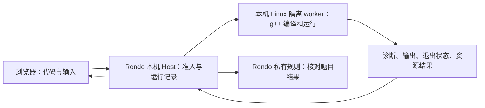

# Rondo 真实 C++ 编译接入增量

> **后续责任更新（2026-10-28）**：Owner 已确认原 A/W 停笔，由本 Rondo 聊天接管正式产品整合与验收。Sol-high 在 `.work/mvp-20261028/candidate/` 实施接线；本文件下文关于 A/W 的责任是独立工作台交付时的历史边界。b2 原件、8290 及既有学习数据继续保护。

2026-10-28｜状态：独立工作台已由本聊天接收（ACCEPT）：前端 s3 + 后端 b2，在 8290 提供数学、GESP 编程、AI 通识统一入口和真实 C++ 编译运行。Owner 已明确授权准备及启用本机隔离环境。正式产品共享接线仍归原 A/W，学习判分与记录整合不在本次通过范围。

## 1. 当前事实与缺口

- 产品已有 `code.requestRun`、`code.requestCancel` 和 `code.runStatus` 协议位置；`requestRunPayloadSchema` 目前只有 source、compilerContractId、taskId。见[公开信封](../../../.work/r0-r2-20261027/integrated/modules/contracts/public/envelope.ts)。
- [学习服务](../../../.work/r0-r2-20261027/integrated/modules/learning/index.ts) 对上述命令/查询仍明确返回 `CAPABILITY_UNAVAILABLE`。本次定向读取未发现 `workers/cpp` 或实际编译执行装配，因此不能称为已集成编译器。
- 初始核实：本机 `/usr/bin/clang++ --version` 读回 Apple Clang 21.0.0、arm64-apple-darwin27.0.0；`/usr/bin/g++` 路径的存在不能证明安装了 GNU GCC。随后获准后已复用本机 OrbStack，安装并验证独立 GNU g++ 镜像；产品 `integrated` 中上述不可用状态仍未改变。
- 前端“理解步骤”中的循环、变量和输出属于受限教学模型；“写 C++”已经接到独立真实编译器。三类样例统一入口仍不代表正式 DSH Host、判分与持久化接线完成。

本轮独立工作台的编译、浏览器结果与取消恢复已接收，达到本轮停止条件。正式产品后续需由 A/W 将现有 `code.*` 接到该执行器和学习记录；普通 macOS 子进程不能替代该执行边界。

## 2. 编译器与执行位置

建议的首个兼容基线为 **GNU g++ 13.2.0，`-O2 -std=c++11 -DONLINE_JUDGE`**。[GESP 官方环境页面](https://gesp.ccf.org.cn/101/1002/10032.html)于本次读取时列出该组合；[2026-01-28 官方修订说明](https://gesp.ccf.org.cn/101/1002/10255.html)规定题目默认以 C++11 为准，另有题目说明时从其说明。环境页同时保留旧 IDE 最低版本文字，故这是本次选定的兼容目标，不是已证明与所有考场环境完全一致。后续发生官方变更时，新建编译合同版本，不静默改写旧运行记录。

沿用[架构基线第 9 节](../20261026/ARCHITECTURE.md#9-c真实执行与教学步进两条明确边界)的本机受控 Linux 虚拟机方案：

浏览器优先不要求编译器运行在浏览器内。孩子使用同一个页面，源代码与输入留在本机；编译和运行均在隔离边界内。worker 不接家庭数据库、答案库、模型凭据或宿主共享目录，运行程序不联网。容器可作为受控 VM 内的实现手段，但命令参数本身不能证明隔离有效；不在本轮同时建设云端编译或第二套 WASM 执行器。

独立后端已冻结 Linux arm64、GNU g++ 13.2.0、基础镜像 digest、监督器源码和运行镜像，详见 [worker-lock.json](../../../.work/cpp-20261028/worker-lock.json)。当前运行镜像为 `sha256:00f70585809a285945fc3e4c2f01712214df58eeefa7499cd220d306f528c980`；[18 项原始验证](../../../.work/cpp-20261028/evidence/verification-2026-10-28T07-39-53.890Z.json)绑定此镜像。该范围不包括正式产品 Host 接线、真实儿童使用或与所有考场平台完全等价。

## 3. 孩子看到的编程工作台

同一编程课内提供两个有明确名字的操作面：

| 操作面 | 行为与反馈 |
| --- | --- |
| 理解步骤 | 受限步骤卡、当前执行行、变量旧值/新值、循环轮次与输出；只解释登记过的教学模板 |
| 写 C++ 并运行 | 编辑完整 C++、输入测试数据、编译并运行；显示可定位到代码行的诊断、标准输出、程序错误及停止结果 |

真实运行入口需要支持一次提交、运行中状态、停止、重新运行和返回课程。提交时固定该次代码与输入；孩子继续编辑后，旧结果标明对应旧版本，不能显示成新代码的输出。编译失败时不运行上次留下的可执行文件。编译信息保留原文与位置，中文解释只作辅助，不能改写错误事实。

任意 C++ 不承诺可逐步解释；不匹配教学模板时仍可真实编译，但明确提示该段代码暂不提供步骤演示。样例通过只代表对应输入的结果；任务正确性仍由 Rondo 私有规则确定，不由编辑器或 worker 判定学习掌握。

## 4. 原执行链的最小接线范围

1. 扩展既有 `code.*` 合同及回执，绑定代码/输入快照、编译合同、job、请求与当前学习上下文；不新增另一套学习生命周期。现有 source 的字符串长度限制需在接收边界按 UTF-8 字节复核，实际输入与完整编译身份也须入合同。
2. 在 Host 准入后交给固定 worker，使用固定参数，不执行前端拼接的 shell 命令。沿用原架构的队列、编译、运行、结束和取消状态；实际停止前不宣称取消完成，重试不重复启动原 job。
3. 浏览器经现有受限网关读取状态和结果；worker 仅返回运行事实，Host 持有题目真值。运行结果能绑定原代码、编译器与输入，不能只留下一个“通过”标志。
4. 按第 3 节接入编程工作台。没有合格执行环境时明确显示不可用，步骤学习仍可使用，不退回直接运行学生本机进程。

共享协议、持久化调整、Host 装配及正式产品 UI 的修改仍由原 A/W 统一安排。本轮已获准的独立编译器与工作台按第 6 节分离目录实施；没有改动原共享协议、schema、运行数据或在途候选。

## 5. 可观察的完成条件

在同一个浏览器课程入口，使用合成身份，真实完成：正确程序输出；语法错误定位；不同输入产生对应结果；修改代码后旧结果不混用；死循环可按限额终止；运行中停止有真实终态；输出/内存/进程和文件访问限制生效；重复请求只关联原作业；回看保留准确代码与执行身份。各项证据绑定同一冻结候选与运行环境。

资源值沿用原架构第 9 节的待验证合同，实施时按实际环境冻结并验证，不在此另设一套数字。源码检查通过、命令路径存在或正常程序跑通，都不能单独证明学生代码执行边界合格。真实儿童数据与学习效果不在本次技术接入验收中。

## 6. 本轮授权与责任

Owner 已于本聊天明确回复“纳入本轮，允许准备并启用本机隔离编译环境”。本聊天先在独立 `.work/cpp-20261028/` 准备、启用和验证编译执行能力，再接到独立前端工作台；不并写 `integrated`、原内容树、运行数据或 A/W 恢复记录。原生设计 writer 继续独占 `opendesign/`。正式学习产品的共享合同、Host、判分与学习记录接线仍由原 A/W 承担，独立工作台通过不冒充这些接线已经完成。

已读回的可用本机环境为 OrbStack Docker Engine 29.8.2、Linux arm64、cgroup v2 与内置 seccomp；连接为本机 Unix socket。本轮复用该环境，不切换全局 Docker context、不重启既有 VM，也不修改其他项目容器。

后端当前接收：`rondo-cpp-workbench-20261028-b2`，启动/运行、限制与回执均有同候选证据，18/18 通过。[独立工作台说明与证据](../../../.work/cpp-20261028/README.md)保留首轮失败、取消竞争修正、监督器描述符缺口及修正后读回。服务只监听 `127.0.0.1:8290`，静态前端同源；代码、输入与作业不写入正式学习档案。

## 7. 本轮稳定接收

2026-10-28 本聊天给出 **ACCEPT，仅限独立三领域样例及本机真实编译工作台**。前端 `rondo-studio-20261028-s3`，14 文件聚合 SHA-256 `d45f56ca4241a76cc0efefd43c4416a5f9e60ccd5ba8f9bc21adafe102cf5ec9`；后端仍为 b2。主控已核对 14 个实际文件与冻结指纹一致，8290 返回的编程模块字节相同；运行读回为 GNU g++ 13.2.0 / C++11、上述镜像和实例 `4197f7a6-fdc1-4320-8a0f-61a3cdc858af`。

- 数学沿用已接收 a2；三领域 s1 的 35 项检查证明步骤变量/输出、修改例子后的真实分类计算、导航及手机模拟操作。未改的实现与原始证据继续有效。
- 真实编译前端 s2 的 35 项检查证明 `45 → 55 → 210`、独立输入输出、语法错误定位、旧结果身份、文本输出、停止及同 job 网络恢复；后端 b2 的 18 项检查单独证明编译和已测试的执行限制。
- s3 只修复 GET 失败后直接停止时 UI 停在 `CANCEL_REQUESTED` 的具名缺口。两个真实场景共 13 项通过，UI 跟随原 job 到 `CANCELLED`；每场景一次提交、一次停止，无重新执行。其余 13 文件不变，未重跑旧全套。见[交付与修复说明](../../../opendesign/mockups/rondo-studio/DELIVERY.md)、[原始复现](../../../opendesign/mockups/rondo-studio/evidence/s3/reproduction.json)、[修复验证](../../../opendesign/mockups/rondo-studio/evidence/s3/verification.json)。

使用入口：<http://127.0.0.1:8290/opendesign/mockups/rondo-studio/index.html#code>，编程中选择“写 C++”。源码、输入与历史只在当前进程/页面内存中；刷新不保存编辑和学习进度。AI 使用合成例子的本地最近邻分类，无在线模型调用。本次不证明完整 GESP 课程、真实 iPhone/Safari、正式学习记录或真实学习效果，也未单独故障注入 POST 回包丢失。Owner 的最终视觉方向选择继续独立保留。
